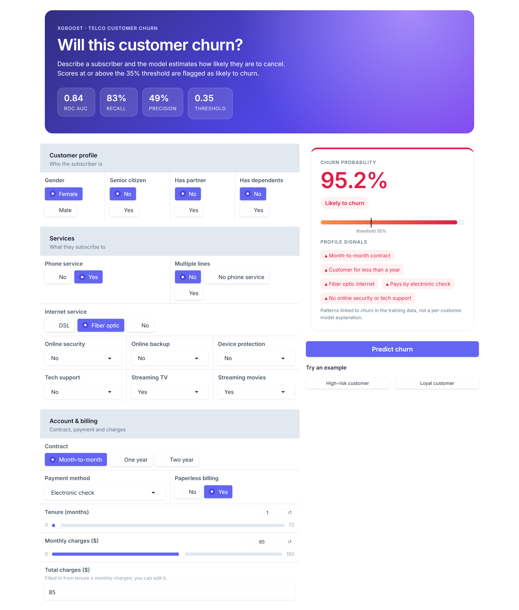
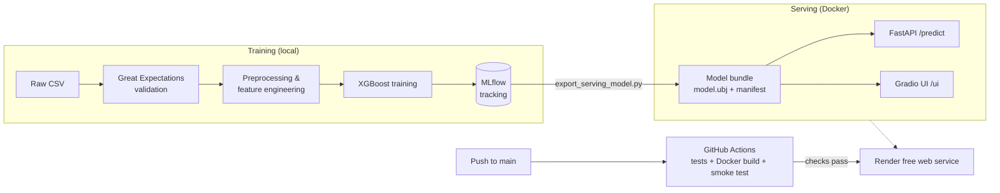

# Telco Customer Churn Prediction

[](https://github.com/al-rafi-DSC/Telco_Customer_Churn/actions/workflows/ci.yml)
[](https://telco-churn-rqga.onrender.com/ui)


An end-to-end machine learning project that predicts whether a telecom customer is likely to cancel their subscription. It covers the full lifecycle: exploratory analysis, data validation, feature engineering, XGBoost training with MLflow tracking, a FastAPI + Gradio inference service, Docker packaging, CI testing on GitHub Actions and free hosting on Render.

**Live demo:** https://telco-churn-rqga.onrender.com/ui · **API docs:** https://telco-churn-rqga.onrender.com/docs

> The demo runs on Render's free tier and sleeps when idle, so the first request after a quiet period can take 30–60 seconds.



---

## Contents

- [Business problem](#business-problem)
- [Results](#results)
- [How it works](#how-it-works)
- [Tech stack](#tech-stack)
- [Project structure](#project-structure)
- [Getting started](#getting-started)
- [Using the API](#using-the-api)
- [Testing and CI](#testing-and-ci)
- [Deployment](#deployment)
- [Limitations and next steps](#limitations-and-next-steps)
- [Acknowledgements](#acknowledgements)

## Business problem

Acquiring a new subscriber costs far more than keeping an existing one. If a telecom provider can identify customers who are about to leave, the retention team can step in with targeted offers before they cancel.

This project trains a classifier on the [IBM Telco Customer Churn dataset](https://www.kaggle.com/datasets/blastchar/telco-customer-churn) (7,043 customers, 19 features covering demographics, subscribed services, contract and billing) and serves it as an app anyone can try.

Because missing a churner is more costly than contacting a loyal customer, the model is tuned for **recall**: the decision threshold is lowered from the default 0.5 to **0.35**.

## Results

Evaluated on a stratified 20% hold-out set (1,409 customers):

| Metric | Score | What it means |
|---|---|---|
| **Recall** | **0.83** | Catches 83% of customers who actually churn |
| Precision | 0.49 | About half of flagged customers actually churn |
| F1 | 0.62 | Balance of precision and recall |
| ROC AUC | 0.84 | Ranking quality, independent of threshold |

These values come from MLflow run `02266b2be48c4d9ebac114c1632dd273`, the run that is packaged and served in production ([`src/serving/bundle/manifest.json`](src/serving/bundle/manifest.json)).

The trade-off is intentional: at threshold 0.35, the model flags more customers to catch most real churners, which suits a low-cost retention action such as an email or discount offer.

**Key churn drivers found in the EDA** ([`notebooks/EDA.ipynb`](notebooks/EDA.ipynb)): month-to-month contracts, short tenure, fiber optic internet, electronic check payments and the absence of online security or tech support.

## How it works



1. **Validate.** Great Expectations checks the raw data (required columns, allowed category values, numeric ranges) before anything is trained. A failed check stops the pipeline.
2. **Preprocess and engineer features.** Drop IDs, fix `TotalCharges`, encode binary columns as 0/1 and one-hot encode multi-category columns.
3. **Train.** XGBoost with tuned hyperparameters and `scale_pos_weight` to handle the 73/27 class imbalance. Parameters, metrics and the model are logged to MLflow.
4. **Export.** A chosen MLflow run is exported to a small, checksummed bundle in XGBoost's native format. Serving never picks a "latest" run automatically.
5. **Serve.** One FastAPI app exposes a validated REST endpoint and mounts the Gradio UI. Both use the same Pydantic schema and the same encoding as training, which is covered by a regression test.

## Tech stack

| Area | Tools |
|---|---|
| Data & modelling | pandas, scikit-learn, XGBoost, Optuna (tuning experiments) |
| Data validation | Great Expectations |
| Experiment tracking | MLflow |
| Serving | FastAPI, Pydantic, Gradio, Uvicorn |
| Packaging | Docker (`python:3.11-slim`, non-root user, health check) |
| CI | GitHub Actions |
| Hosting | Render (free tier, Blueprint in `render.yaml`) |

## Project structure

```text
├── .github/workflows/ci.yml      # Tests, Docker build and smoke test on every push/PR
├── data/raw/                     # Telco CSV (not committed)
├── docs/images/                  # README screenshots
├── notebooks/EDA.ipynb           # Exploratory analysis and model experiments
├── scripts/
│   ├── run_pipeline.py           # End-to-end training pipeline with MLflow logging
│   ├── export_serving_model.py   # Export a chosen MLflow run to the serving bundle
│   └── smoke_test.py             # Checks a running deployment (health, UI, prediction)
├── src/
│   ├── app/                      # FastAPI app, Gradio UI and server entry point
│   ├── data/                     # Loading and preprocessing
│   ├── features/                 # Feature engineering
│   ├── models/                   # Training, tuning and evaluation helpers
│   ├── serving/
│   │   ├── inference.py          # Serving-time transformation and prediction
│   │   └── bundle/               # Deployed model (model.ubj + manifest.json)
│   └── utils/validate_data.py    # Great Expectations data checks
├── tests/                        # Unit and regression tests
├── Dockerfile
├── render.yaml                   # Render free-tier service definition
├── requirements.txt              # Full training environment
└── requirements-serving.txt      # Minimal serving environment used by Docker
```

## Getting started

### Prerequisites

- Python 3.11
- Docker (optional, for running the container)
- The dataset at `data/raw/Telco-Customer-Churn.csv` (only needed for training)

### Run the app locally

```bash
git clone https://github.com/al-rafi-DSC/Telco_Customer_Churn.git
cd Telco_Customer_Churn

python -m venv .venv-serving
# Windows: .venv-serving\Scripts\activate   macOS/Linux: source .venv-serving/bin/activate
pip install -r requirements-serving.txt

python -m src.app.serve
```

Open http://127.0.0.1:8000/ui for the web app or http://127.0.0.1:8000/docs for the interactive API.

### Run with Docker

```bash
docker build -t telco-churn-app .
docker run --rm -p 8000:8000 telco-churn-app
```

### Train a new model

Training uses the full environment in `requirements.txt`, kept separate from the slim serving image:

```bash
python -m venv .venv
pip install -r requirements.txt

python scripts/run_pipeline.py --input data/raw/Telco-Customer-Churn.csv --target Churn
mlflow ui --backend-store-uri file:./mlruns           # compare runs
python scripts/export_serving_model.py --run-id <RUN_ID>   # promote a run to serving
```

See [RUN_ORDER.md](RUN_ORDER.md) for what each script does and in which order.

## Using the API

`POST /predict` takes all 19 customer fields and returns the label, the churn probability and the threshold used:

```bash
curl -X POST https://telco-churn-rqga.onrender.com/predict \
  -H "Content-Type: application/json" \
  -d '{
    "gender": "Female", "SeniorCitizen": 0, "Partner": "No", "Dependents": "No",
    "PhoneService": "Yes", "MultipleLines": "No", "InternetService": "Fiber optic",
    "OnlineSecurity": "No", "OnlineBackup": "No", "DeviceProtection": "No",
    "TechSupport": "No", "StreamingTV": "Yes", "StreamingMovies": "Yes",
    "Contract": "Month-to-month", "PaperlessBilling": "Yes",
    "PaymentMethod": "Electronic check", "tenure": 1,
    "MonthlyCharges": 85.0, "TotalCharges": 85.0
  }'
```

```json
{"prediction": "Likely to churn", "churn_probability": 0.952, "threshold": 0.35}
```

| Endpoint | Method | Description |
|---|---|---|
| `/` | GET | Health check, returns `{"status": "ok"}` |
| `/predict` | POST | Churn prediction; invalid or missing fields return HTTP 422 |
| `/ui` | GET | Gradio web interface |
| `/docs` | GET | Interactive OpenAPI documentation |

## Testing and CI

```bash
python -m unittest discover -s tests -v
```

The tests cover:
- training and serving producing identical feature encodings for every category
- the threshold being applied to probabilities
- API input validation
- error handling
- UI behaviour
- data-validation rules

On every push and pull request, [GitHub Actions](.github/workflows/ci.yml):

1. runs the test suite
2. builds the Docker image
3. starts it with a 512 MB memory limit (matching the free hosting tier)
4. runs [`scripts/smoke_test.py`](scripts/smoke_test.py) against the running container: health, UI, docs and a real prediction

## Deployment

The app is deployed to **Render's free tier** straight from this repository, with no cloud bill and no registry credentials:

- [`render.yaml`](render.yaml) defines a Docker web service on the free plan, with `/` as the health check.
- Render redeploys automatically after CI passes on `main`.
- The model is baked into the image, so the service needs no MLflow server, database or AWS resources at runtime.

Step-by-step instructions, including local Docker testing and updating the deployed model, are in [DEPLOYMENT.md](DEPLOYMENT.md).

> The original version of this project was deployed on AWS ECS Fargate behind an Application Load Balancer, with images pushed to Docker Hub. It was moved to Render to keep the public demo free to run.

## Limitations and next steps

- **Precision is moderate (49%).** Fine for low-cost outreach, but a costlier intervention would call for a higher threshold, chosen from a cost-benefit analysis.
- **"Profile signals" in the UI are dataset-level patterns,** not per-prediction explanations. Adding SHAP values would explain each individual score.
- **Static model.** There is no scheduled retraining or drift monitoring. Next steps would be logging predictions and tracking feature drift.
- **Free hosting.** Cold starts and limited CPU/RAM. Fine for a demo, not for production traffic.

## Acknowledgements

- Based on the original project by [anesriad](https://github.com/anesriad/Telco-Customer-Churn-ML), extended with a redesigned UI, a checksummed model bundle, regression tests, CI smoke testing and free deployment on Render.
- Dataset: [IBM Telco Customer Churn](https://www.kaggle.com/datasets/blastchar/telco-customer-churn) sample data.

**Author:** Sayed Al Rafi · [GitHub](https://github.com/al-rafi-DSC)
