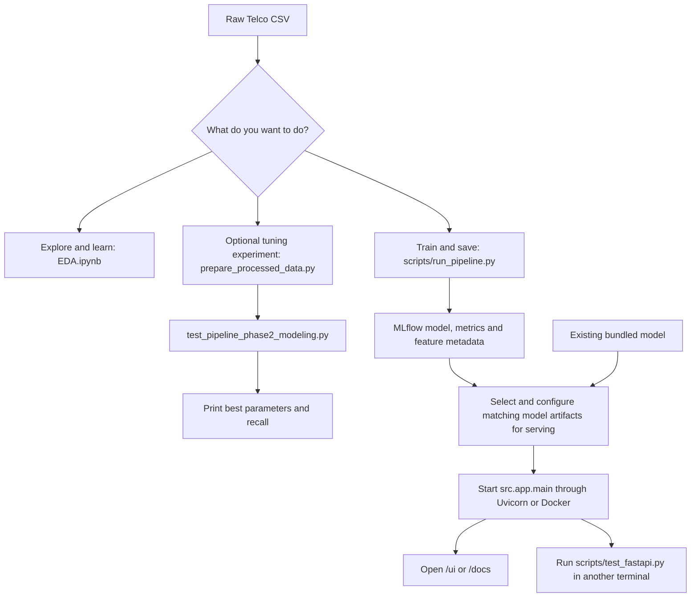

# Project run-order guide

Reviewed against the source on 21 October 2026. This guide maps the code; it does not certify a successful training or deployment run.

There is one notebook in this project: `notebooks/EDA.ipynb`. The other executable files are Python scripts or modules. You do not need to run every file in sequence.

## Choose your task



The notebook and tuning experiment are optional. Their results do not automatically update `run_pipeline.py` or the model bundled by Docker. The model-configuration step is currently manual and needs the path issues below addressed.

## 1. The main training route

Run commands from the project root, `Telco-Customer-Churn-ML`, in a Python environment containing the project dependencies. The dependency list is in `requirements.txt`; compatibility still needs checking before treating this as a clean-install recipe.

The training entry point is:

```powershell
python scripts/run_pipeline.py --input data/raw/Telco-Customer-Churn.csv --target Churn
```

That single command performs this sequence internally:

| Order | Code used | What happens |
|---|---|---|
| 1 | `scripts/run_pipeline.py` | Configures MLflow and starts a run. |
| 2 | `src/data/load_data.py` | Reads the raw CSV. |
| 3 | `src/utils/validate_data.py` | Checks data quality; a failed check stops training. |
| 4 | `src/data/preprocess.py` | Removes IDs, converts charges and target, fills numeric missing values. |
| 5 | `scripts/run_pipeline.py` | Saves the cleaned, not yet one-hot-encoded CSV. |
| 6 | `src/features/build_features.py` | Encodes binary and multi-category features. |
| 7 | `scripts/run_pipeline.py` | Saves feature names and preprocessing metadata. |
| 8 | `scripts/run_pipeline.py` | Splits into train/test sets and calculates class weights. |
| 9 | `scripts/run_pipeline.py` | Trains XGBoost with hardcoded parameters. |
| 10 | `scripts/run_pipeline.py` | Evaluates probabilities using the configured threshold, default `0.35`. |
| 11 | `scripts/run_pipeline.py` | Logs metrics and saves the model in MLflow. |

Do not run `load_data.py`, `preprocess.py`, or `build_features.py` separately first. They define functions that the entry script calls. The main script implements training and evaluation itself; it does not call `src/models/train.py`, `tune.py`, or `evaluate.py`.

Expected outputs after successful training:

- `data/processed/telco_churn_processed.csv`: cleaned data before feature encoding.
- `artifacts/feature_columns.json`: ordered input feature names.
- `artifacts/preprocessing.pkl`: feature-name and target metadata, not a fitted encoder.
- `mlruns/`: experiment records, metrics, model, `feature_columns.txt`, and preprocessing metadata, unless a different tracking URI is supplied.

Optional: inspect results in another terminal using `mlflow ui --backend-store-uri ./mlruns`.

## 2. Notebook order for learning and experiments

Open `notebooks/EDA.ipynb`, start with a fresh kernel, and execute code cells in document order. The numbers below are physical cell positions, counting markdown cells too; they are not the notebook's execution counters such as `[12]`.

| Order | Cells | Section and dependency |
|---|---|---|
| 1 | 4–10 | Imports, raw-data loading, and inspection. Cell 7 only previews the processed CSV in `df1`; later modeling uses `df`. |
| 2 | 13–14 | Binary encoding: Yes/No and gender. Requires the raw `df`. |
| 3 | 16–17 | One-hot encoding. Requires the original multi-category columns. |
| 4 | 19–22 | Convert charges, drop customer ID, convert boolean columns. |
| 5 | 23–24 | Correlations and heatmap. |
| 6 | 27–29 | Collapse redundant features and calculate VIF. Cell 27 changes `df` used by later models. |
| 7 | 32, 35 | Inspect class balance, create `X` and `y`, split data, set `THRESHOLD`. |
| 8 | 37–38 | Train Random Forest, then compare its thresholds. |
| 9 | 41, 43 | Train LightGBM, then compare its thresholds. |
| 10 | 45–46 | Train XGBoost, then compare its thresholds. |
| 11 | 49 | Run Optuna; creates `study` using the split from cell 35. |
| 12 | 50 | Train and evaluate XGBoost using `study.best_params`. |
| 13 | 51 | Train again and log a model plus metrics to MLflow. Requires `study` and the split; it does not merely save the model from cell 50. |

The three model-comparison branches all depend on the split in cell 35; Random Forest is not a prerequisite for LightGBM or XGBoost. Each threshold-comparison cell does require its own model-training cell first.

Notebook details that matter:

- If the processed CSV is missing, run `python scripts/prepare_processed_data.py` from the project root before cell 7, or skip cell 7 because `df1` is only a preview.
- The CSV paths are absolute paths. Update them if the project moves.
- Cell 51 assumes the kernel's current working directory is `notebooks/`, because it takes the parent as the project root. Check the working directory before logging.
- Re-running the encoding or column-dropping cells on an already transformed `df` can fail or change results. Restart from the raw-data load when repeating preprocessing.
- The notebook's feature schema differs from the main pipeline because cell 27 collapses features. Its saved model does not automatically fit the serving schema.
- Tuning repeatedly uses `X_test`/`y_test`. Treat these as tuning results; use a separate untouched test set for final performance reporting.

## 3. Optional standalone tuning route

Run these two commands in this order:

```powershell
python scripts/prepare_processed_data.py
python scripts/test_pipeline_phase2_modeling.py
```

The first writes encoded numeric features to the processed CSV. The second reads that file, runs 30 Optuna trials with threshold `0.4`, and prints best parameters and recall. Despite its filename, it is a training/tuning experiment, not a small automated test. It does not save a serving model or pass its parameters into the main pipeline.

**Shared-file conflict:** `prepare_processed_data.py` saves encoded data to `data/processed/telco_churn_processed.csv`, but `run_pipeline.py` writes cleaned, unencoded data to that same filename. Therefore, regenerate the encoded CSV immediately before the phase 2 experiment if the main pipeline has run since preparation. The phase 1 test prints results but does not create this CSV.

## 4. Serving, GitHub and deployment

See [DEPLOYMENT.md](DEPLOYMENT.md) for the current commands. The serving environment is separate from the training `.venv` and uses `requirements-serving.txt`.

Training does not automatically deploy. Select a FINISHED MLflow run, run `scripts/export_serving_model.py --run-id RUN_ID`, and commit the two files in `src/serving/bundle/`. Docker or `.venv-serving` loads that explicit model and threshold. Start the app, then run `scripts/smoke_test.py` in a second terminal. The UI is at `/ui` and the API at `/predict`.

The main entry point is `src.app.main:app`; `src/app/app.py` now aliases it. `src/app/serve.py` starts the server and reads the hosting platform's `PORT`.

## 5. Other helpers

- `src/models/train.py`, `tune.py`, and `evaluate.py` are optional imported helpers, not stages automatically called by the main pipeline.
- `src/utils/utils.py` defines a logger, not an executable pipeline stage.
- `scripts/test_pipeline_phase1_data_features.py` is an optional inspection script with a macOS path that needs adjusting.
- `scripts/test_fastapi.py` is an optional sample request for an already running API.
- `Dockerfile` builds the serving image from the selected bundle; it does not train.
- `.github/workflows/ci.yml` tests and builds on pull requests and pushes to `main`. It no longer publishes to Docker Hub. Render can deploy after these checks pass.

## What run order cannot fix

The Windows tracking URI, console encoding, and Great Expectations 1.5.8 validation compatibility were fixed on 21 October 2026. The full main pipeline completed and saved an MLflow model using `.venv/Scripts/python.exe`. Validation now checks numeric strings on a copy of the raw data, allows blank TotalCharges for preprocessing, and rejects invalid numeric text. Serving now preserves single-row categories, includes SeniorCitizen, and applies the exported threshold. Use the project virtual environment; the system Python may not have the dependencies installed.

For studying the code, follow: `load_data.py` → `validate_data.py` → `preprocess.py` → `build_features.py` → `run_pipeline.py` → `inference.py` → `main.py`. For execution, start with the appropriate entry command above and let it call the helper functions.
